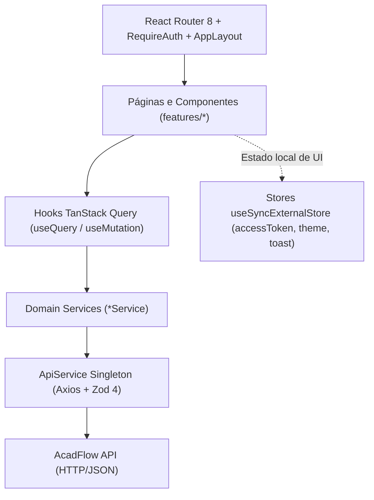
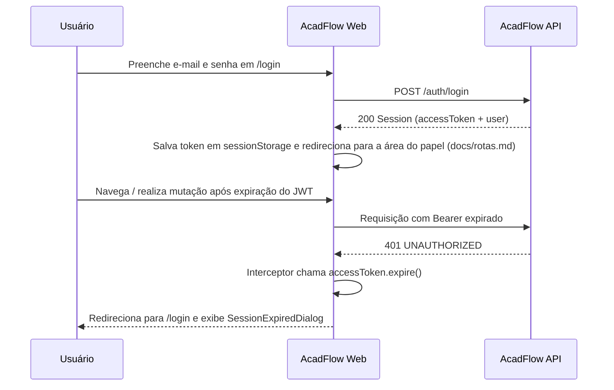
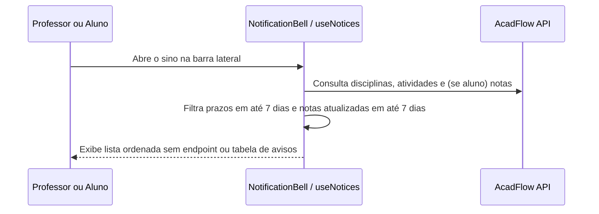

# AcadFlow Web — Arquitetura

**Stack:** Node.js 24 · pnpm 12 · React 19 · Vite 8 · TypeScript 6 (`strict`) · React Router 8 · TanStack Query 5 · Axios · React Hook Form + Zod 4 · Tailwind CSS 4 · `react-i18next` · Vitest 5 + Testing Library · Oxlint/Oxfmt.  
**Repositórios:** [acadflow-api](https://github.com/DevCaverna/acadflow-api) · [acadflow-design](https://github.com/DevCaverna/acadflow-design)  
**Linear:** [Arquitetura API/Web, i18n, TanStack Query e Migrations](https://linear.app/acadflow/document/acadflow-arquitetura-apiweb-i18n-tanstack-query-e-migrations-15ff46ed6d06)

## Visão Geral e Organização por Domínio

A aplicação web segue uma arquitetura **feature-sliced por domínio**, em que cada funcionalidade agrupa seus próprios contratos Zod, serviços HTTP, hooks de cache/mutação, componentes e páginas:

```text
src/
  main.tsx                       # Mount (StrictMode -> AppProviders -> RouterProvider)
  app/
    providers/AppProviders.tsx   # QueryClientProvider (staleTime 30s) e inicialização i18n
    router/                      # router.tsx, routes.tsx, RequireAuth, AppLayout, NotFoundPage
  shared/
    api/                         # ApiService singleton, access-token store, api-error, listing.schema
    components/                  # componentes base reutilizáveis + arquivos de teste
    config/time.constants.ts     # Constantes de duração (QUERY_STALE_MS, REQUEST_TIMEOUT_MS, DEFAULT_TOAST_MS)
    lib/                         # cn, file (AVATAR_RULES/ATTACHMENT_RULES), format, theme, toast
  features/
    auth/                        # LoginPage, SessionExpiredDialog, useCurrentUser, useLogin, useLogout
    home/                        # HomePage, ProfessorHome, StudentHome
    landing/                     # LandingPage (pública)
    disciplines/                 # DisciplinesPage, DisciplinePage, DisciplineFormModal, DisciplineList, StudentList
    enrollments/                 # EnrollModal, hooks/services de matrícula e busca de candidatos
    activities/                  # ActivityList, ActivityFormModal, AttachmentsModal, DueBadge, GradedProgress
    grades/                      # GradesPage, GradeEntry (professor), MyGrades (aluno), GradeStatusBadge, parseGrade
    notifications/               # NotificationBell, NotificationPanel, useNotices (avisos derivados no cliente)
    profile/                     # ProfilePage, AvatarForm, ProfileForm, PasswordForm
  i18n/                          # Config i18next e locales pt-BR (padrão) e en (11 namespaces)
  styles/index.css               # Tailwind CSS v4 @theme + variáveis do tema escuro [data-theme='dark']
test/                            # setup.ts, mock-api.ts (adapter Axios), query-wrapper.tsx, render-app.tsx
```

## Fluxo de Dados e Camadas



### Gestão de Estado

- **Estado remoto (server state):** gerenciado exclusivamente pelo **TanStack Query v5** (`staleTime` de 30s; retry automático até 2x apenas em erros de rede/5xx, nunca em `4xx`).
- **Stores leves com `useSyncExternalStore` (sem Redux):**
  - `accessToken` (`src/shared/api/access-token.ts`): persiste JWT em `sessionStorage['acadflow.accessToken']` e sinaliza expiração em memória.
  - `themeStore` (`src/shared/lib/theme.ts`): controla `document.documentElement.dataset.theme` (`light` | `dark`) e `localStorage['acadflow.theme']`, em conjunto com o script anti-FOUC em `index.html`.
  - `toastStore` (`src/shared/lib/toast.ts`): fila de notificações toast com descarte automático em 5s.
- **Usuário autenticado:** `RequireAuth` resolve `GET /auth/me` via `useCurrentUser()`, entrega `user` ao `AppLayout` e propaga via React Router `<Outlet context={user} />` (`useAuthUser()`).

### Fronteira HTTP e Validação

- `ApiService` (`src/shared/api/api.service.ts`) é o único ponto que instancia Axios:
  - Injeta `Accept-Language` (`pt-BR` ou `en`) e `Authorization: Bearer <token>` em toda requisição.
  - Valida todas as respostas da API em tempo de execução com schemas **Zod 4**.
  - Normaliza falhas no contrato `{ statusCode, code, message }`.

## Fluxos Críticos

### Autenticação e Expiração de Sessão (`401`)



### Sino de Avisos Derivado no Cliente



## Referências Complementares

- [Design System e Componentes](design-system.md)
- [Manual do Usuário](manual-do-usuario.md)
- [Rastreabilidade Design × Web × API](rastreabilidade.md)
- [ADRs do Frontend](adr/README.md)
- [Deploy do Frontend](execucao/deploy.md)
