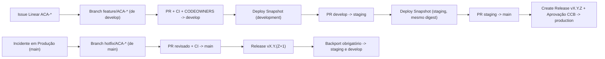

# Plano de Gerência de Configuração de Software (GCS) — AcadFlow Web

Este documento formaliza o **Plano de Gerência de Configuração de Software** do **AcadFlow Web**, alinhado à norma **IEEE Std 828 / ISO 10007 (SWEBOK)**, conectando os artefatos de interface, dependências, Docker, CI/CD e releases aos quatro processos clássicos de GCS: **Identificação**, **Controle de Mudanças**, **Contabilização de Status** e **Auditorias**.

---

## 1. Objetivo, Escopo e Papéis (CCB)

- **Escopo:** cobre todos os artefatos versionados de `DevCaverna/acadflow-web` e sua integração com `DevCaverna/acadflow-api` e `DevCaverna/acadflow-design`.
- **Comitê de Controle de Mudanças (CCB):** opera via revisão obrigatória de Pull Requests por mantenedores em `.github/CODEOWNERS`, checks automáticos (`Web / Validate` e `Web / Build`) e aprovação manual explícita no Environment `production` (sem autoaprovação).

| Papel no Projeto                   | Responsável (GitHub) | Atuação em GCS                                               |
| ---------------------------------- | -------------------- | ------------------------------------------------------------ |
| Interface Web, Features React e UX | `@OtavioGonzaga`     | Implementação de features, tokens do design, testes e i18n   |
| Infraestrutura, CI/CD e Releases   | `@aqu1no1`           | Docker/Nginx, runtime-config, pipelines GHCR/VPS e workflows |
| Alinhamento API/Web e Documentação | `@Vinicius-Antonio`  | Rastreabilidade Design × Web × API, ADRs, manual e PGC       |

---

## 2. Identificação de Configuração

### 2.1 Catálogo de Itens de Configuração (ICs)

| ID          | Item de Configuração                   | Localização                                                      | Versionamento / Identificação                            | Responsável                                   |
| ----------- | -------------------------------------- | ---------------------------------------------------------------- | -------------------------------------------------------- | --------------------------------------------- |
| `IC-WEB-01` | Código-fonte React/TypeScript          | `src/` (`app/`, `shared/`, `features/`, `styles/`)               | Git SHA + Tag SemVer `vX.Y.Z`                            | `@OtavioGonzaga`                              |
| `IC-WEB-02` | Recursos de internacionalização        | `src/i18n/locales/` (`pt-BR` e `en`)                             | Git SHA (validado por `i18n.test.ts`)                    | `@OtavioGonzaga`                              |
| `IC-WEB-03` | Manifesto e lockfile de dependências   | `package.json`, `pnpm-lock.yaml`                                 | Lockfile congelado (`--frozen-lockfile`)                 | `@aqu1no1`                                    |
| `IC-WEB-04` | Configuração pública de runtime e env  | `.env.example`, `public/runtime-config.js`, `src/types/env.d.ts` | Template versionado; valor público injetado por ambiente | `@aqu1no1`                                    |
| `IC-WEB-05` | Suíte de testes e mocks HTTP           | `test/`, `src/**/*.test.{ts,tsx}`                                | Git SHA (Vitest + Testing Library)                       | `@OtavioGonzaga`                              |
| `IC-WEB-06` | Contêiner Nginx SPA e scripts          | `docker/`, `scripts/deploy-web.sh`                               | Git SHA + Imagem OCI no GHCR                             | `@aqu1no1`                                    |
| `IC-WEB-07` | Pipelines CI/CD e políticas de entrega | `.github/workflows/`, `.github/scripts/`                         | Git SHA (validado por `delivery.test.sh`)                | `@aqu1no1`                                    |
| `IC-WEB-08` | Contratos mock e documentação          | `README.md`, `AGENTS.md`, `docs/`, `CHANGELOG.md`                | Git SHA + revisão em PR                                  | `@Vinicius-Antonio`                           |
| `IC-WEB-09` | Artefato OCI, SBOM e Assinatura        | GHCR `acadflow-web`                                              | Digest `sha256:...` + SBOM SPDX + Cosign OIDC            | Pipeline `Deploy Snapshot` / `Create Release` |

### 2.2 Linhas de Base (Baselines)

| Baseline                    | Origem                       | Critério de Congelamento                                  | Uso                                        |
| --------------------------- | ---------------------------- | --------------------------------------------------------- | ------------------------------------------ |
| **Baseline de Design**      | `acadflow-design` (`main`)   | PR revisado (`v1.0` → `v1.3`)                             | Referência visual, tokens e acessibilidade |
| **Baseline de Integração**  | Branch `develop`             | PR revisado + `Web / Validate` e `Web / Build` verdes     | Snapshot em `development`                  |
| **Baseline de Homologação** | Branch `staging`             | PR `develop → staging` + mesmo digest de `development`    | Validação integrada com API `staging`      |
| **Baseline de Produção**    | Branch `main` + Tag `vX.Y.Z` | PR `staging → main` + `Create Release` + aprovação humana | Imagem assinada por digest + SBOM          |

### 2.3 Versionamento Semântico (`SemVer 2.0.0`)

As releases utilizam tags imutáveis `vX.Y.Z`:

- **`MAJOR` (`X`):** incompatibilidade de contrato HTTP com a versão vigente da API ou alteração estrutural de fluxos/rotas públicas.
- **`MINOR` (`Y`):** novas telas, fluxos funcionais ou recursos retrocompatíveis (ex.: tema escuro, anexos, perfil).
- **`PATCH` (`Z`):** correções visuais, acessibilidade, traduções, ajustes de build/Nginx ou documentação.

---

## 3. Controle de Mudanças e Fluxo de Branches

### 3.1 Fluxo Padrão e Fluxo de Hotfix Emergencial

### 3.2 Regras de Controle Aplicadas

1. **Vínculo de origem:** alterações partem de issues `ACA-*` no Linear em branches `feature/ACA-*` (ou `hotfix/ACA-*` a partir da `main` em emergências, com backport obrigatório para `staging` e `develop`).
2. **Alinhamento de contrato:** telas podem evoluir com mocks aderentes a [contratos-mock.md](../docs/contratos-mock.md) / [rastreabilidade.md](rastreabilidade.md), mas o contrato real em `acadflow-api` é a fonte definitiva antes de promoção para produção.
3. **Aprovação por `CODEOWNERS`:** mudanças em `.github/workflows/`, `docker/`, `scripts/`, `src/` e `docs/` acionam revisão automática conforme [.github/CODEOWNERS](../.github/CODEOWNERS).
4. **Proteção de branches e tags:** `develop`, `staging` e `main` exigem PR e CI verde; tags `v*` são imutáveis após publicação.
5. **Dependências sob controle:** [.github/dependabot.yml](../.github/dependabot.yml) automatiza atualizações semanais de `npm` (`pnpm`), `docker` e `github-actions` contra `develop`.

---

## 4. Contabilização de Status de Configuração (CSA)

- **Cadeia de rastreio:** `Issue ACA-*` → `PR & Commit SHA` → `Execução CI` → `GitHub Deployment` → `Digest sha256` + `Tag vX.Y.Z` + conteúdo ativo de `/runtime-config.js`.

### Matriz de Configuração por Ambiente

| Aspecto             | Local (Vite)                 | `development`                           | `staging`                               | `production`                                                   |
| ------------------- | ---------------------------- | --------------------------------------- | --------------------------------------- | -------------------------------------------------------------- |
| Origem do código    | `feature/*` ou `develop`     | `develop` (Digest novo)                 | `staging` (Digest promovido)            | `main` (`vX.Y.Z`, Digest promovido)                            |
| Descoberta da API   | `.env` (`VITE_API_BASE_URL`) | `/runtime-config.js` (sem cache)        | `/runtime-config.js` (sem cache)        | `/runtime-config.js` (sem cache)                               |
| Porta na VPS / Host | `5173` (Vite dev)            | `WEB_HOST_PORT` (ex.: `127.0.0.1:4100`) | `WEB_HOST_PORT` (ex.: `127.0.0.1:4200`) | `WEB_HOST_PORT` (ex.: `127.0.0.1:4300`)                        |
| Contêiner interno   | `Dockerfile.dev`             | Nginx não privilegiado (`:8080`)        | Nginx não privilegiado (`:8080`)        | Nginx não privilegiado (`:8080`)                               |
| Aprovação humana    | N/A                          | Acionamento manual                      | Acionamento manual                      | Obrigatória sem autoaprovação                                  |
| Rollback rápido     | `git`                        | Contêiner `-previous` na VPS            | Contêiner `-previous` na VPS            | Contêiner `-previous` (restaura bundle e `/runtime-config.js`) |

---

## 5. Auditorias de Configuração (FCA e PCA)

### 5.1 Auditoria Funcional de Configuração (FCA)

- [ ] `pnpm lint` (`oxlint --type-aware --deny-warnings`, incluindo proibição de imports relativos) com zero erros e zero warnings.
- [ ] `pnpm format:check` (`oxfmt --check`) aprovado.
- [ ] `pnpm typecheck` (`tsc --noEmit` em `app`, `node` e `test`) sem erros.
- [ ] Suíte Vitest + Testing Library passando (74 testes cobrindo fluxos de `PROFESSOR`/`ALUNO`, erros, tema e `pt-BR`/`en`).
- [ ] Acessibilidade e tokens validados conforme [design-system.md](design-system.md) e `.github/PULL_REQUEST_TEMPLATE.md`.

### 5.2 Auditoria Física de Configuração (PCA)

- [ ] Dependências travadas via `pnpm install --frozen-lockfile`.
- [ ] Bundle `dist/` gerado sem erros (`tsc --noEmit && vite build`) e servido via Nginx com fallback SPA (`try_files`).
- [ ] Nenhuma credencial ou segredo exposto em variáveis `VITE_*` ou `/runtime-config.js`.
- [ ] Mesmo digest `sha256` promovido entre `development` → `staging` → `production`.
- [ ] Scan **Trivy** limpo de vulnerabilidades críticas, assinatura **Cosign / OIDC** e **SBOM SPDX** anexados.
- [ ] Consistência entre tag `vX.Y.Z` e [CHANGELOG.md](../CHANGELOG.md).

---

## Referências

- [Arquitetura Web](arquitetura.md) · [Design System](design-system.md)
- [Rastreabilidade Design × Web × API](rastreabilidade.md) · [Manual do Usuário](manual-do-usuario.md)
- [Pipeline CI](CI.md) · [Releases e Deploy](execucao/deploy.md)
